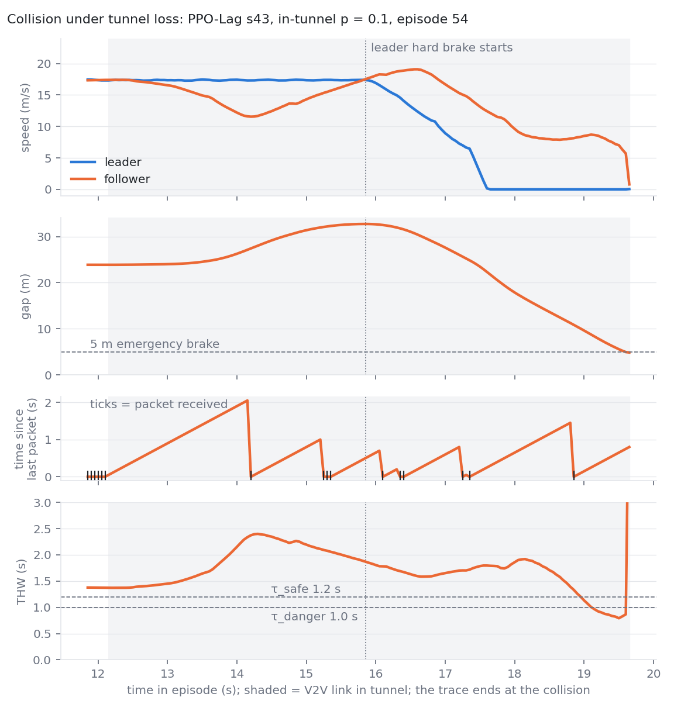

# Tunnel evaluation re-analysis with the paper's metrics (2026-11-17)

> **주의.** PID 수치는 튜닝 전 게인(kd 0.1) 기준이다. 재튜닝 결과는 `2026-11-17_pid_retune.md`에 있다. 11-16 문서의 '4~8배'도 예전 PID 기준이고, 재튜닝 기준은 3.5~6배다.

Offline re-analysis of the evaluation logs behind `2026-11-16_tunnel_eval.md`. Every number comes from the per-step CSVs in `outputs/tunnel/eval/` (42 cells, 100 episodes each). The analysis itself runs no simulation; the three vanilla-PPO cells at p = 1.0 were missing and were evaluated later the same day with the settings of the other p = 1.0 cells. Script: `analysis/tunnel_paper_metrics.py`; full tables in `outputs/tunnel/summary/paper_metrics.md`, one row per episode in `paper_metrics_episodes.csv`.

## 0. What the logs contain

- **Per-step data exists** for every evaluation episode, PID and PPO alike, at 20 Hz (T_s = 0.05 s): leader and follower speed, gap, spacing error, relative velocity, follower acceleration, throttle and brake, packet received (`comm_success`), comm flag, time since the last received packet (`t_since_comm_s`), tunnel flags, the in-tunnel p of that tick, emergency-brake flag, leader-brake flag. THW is not a column; it is gap / follower speed, as in the training code.
- **Training p** (all six runs): 0.9 outside the tunnel; inside the tunnel the mean p is drawn once per episode from U(0.1, 0.9), with noise std 0.1 (1 s correlation time); leader hard-brake probability 0.5.
- Vanilla PPO at p = 1.0 was not part of the 11-16 evaluation; the three cells (`ppo_s4x_t1.0`) were added on 11-17.
- Check of the method: the THW cost recomputed from the step files matches the value logged by the simulator in all 3600 learned-controller episodes (largest difference 0.002).

The definitions below were checked against the reference paper afterwards and match: `2026-11-17_paper_crosscheck.md`.

Definitions (same as `episode_ppo_v2.py`, true simulator state, every step of every episode including launch and final stop):

- r_cont = 2·Δd² + Δv² (eq. 10, Q = diag(2, 1)); r_traf = a²; r_jerk = (a_t − a_{t−1})², a = follower longitudinal acceleration.
- THW cost (eq. 15): 0 if THW ≥ 1.2 s, 1 if THW ≤ 1.0 s, ((1.2 − THW)/0.2)² between. THW is taken as infinite at or below 0.5 m/s.
- Caution region: 1.0 s < THW < 1.2 s. Danger region: THW ≤ 1.0 s. One step = 0.05 s.

"Pooled" rows put the three seeds together (300 episodes). The three seeds drive the same 100 scenarios.

## 1. Six paper metrics at p = 1.0 and 0.9

Step means for the three reward terms; THW cost as the mean per step and the mean sum per episode; region stays as mean steps per episode.

| In-tunnel p | Controller | r_cont | r_traf | r_jerk | THW cost / step | THW cost / episode | Caution steps / ep | Danger steps / ep |
|---|---|---|---|---|---|---|---|---|
| 1.0 | PPO-Lag s42 | 8.22 | 10.75 | 2.74 | 0 | 0 | 0 | 0 |
| 1.0 | PPO-Lag s43 | 9.38 | 10.94 | 2.53 | 0 | 0 | 0 | 0 |
| 1.0 | PPO-Lag s44 | 9.45 | 10.76 | 2.66 | 0 | 0 | 0 | 0 |
| 1.0 | **PPO-Lag pooled** | **9.02** | **10.81** | **2.65** | **0** | **0** | **0** | **0** |
| 1.0 | PPO s42 | 7.59 | 10.75 | 2.66 | 0 | 0 | 0 | 0 |
| 1.0 | PPO s43 | 8.21 | 9.97 | 2.35 | 0 | 0 | 0 | 0 |
| 1.0 | PPO s44 | 8.99 | 10.60 | 2.73 | 0 | 0 | 0 | 0 |
| 1.0 | **PPO pooled** | **8.27** | **10.43** | **2.58** | **0** | **0** | **0** | **0** |
| 0.9 | PPO-Lag s42 | 8.22 | 10.68 | 2.65 | 0 | 0 | 0 | 0 |
| 0.9 | PPO-Lag s43 | 9.47 | 11.22 | 2.64 | 0 | 0 | 0 | 0 |
| 0.9 | PPO-Lag s44 | 9.31 | 10.86 | 2.79 | 0 | 0 | 0 | 0 |
| 0.9 | **PPO-Lag pooled** | **9.00** | **10.92** | **2.69** | **0** | **0** | **0** | **0** |
| 0.9 | PPO s42 | 7.61 | 10.76 | 2.62 | 0 | 0 | 0 | 0 |
| 0.9 | PPO s43 | 8.27 | 10.07 | 2.54 | 0 | 0 | 0 | 0 |
| 0.9 | PPO s44 | 9.22 | 10.64 | 2.76 | 0.00001 | 0.01 | 0.27 | 0 |
| 0.9 | **PPO pooled** | **8.37** | **10.49** | **2.64** | **0.000004** | **0.003** | **0.09** | **0** |

- **Neither algorithm ever enters the Danger region at p ≥ 0.9.** PPO-Lag has no Caution step either; PPO has none at p = 1.0 and 27 (all seed 44, in 100 episodes) at p = 0.9.
- PPO tracks slightly tighter than PPO-Lag (r_cont 8.27 vs 9.02 at p = 1.0, 8.37 vs 9.00 at p = 0.9) with about the same r_traf and r_jerk. The per-seed ranges overlap on all three reward terms.
- Both algorithms are the same at p = 1.0 and at p = 0.9 within seed-to-seed spread.

## 2. THW cost and Danger-region stay over all p

THW cost is the mean sum per episode; Danger is the mean stay per episode in steps (seconds in brackets). PID is given for reference (old gains, kd 0.1; the retuned PID is in `2026-11-17_pid_retune.md`).

| In-tunnel p | PID | PPO-Lag pooled | PPO-Lag s42 / s43 / s44 | PPO pooled | PPO s42 / s43 / s44 |
|---|---|---|---|---|---|
| **THW cost / episode** | | | | | |
| 1.0 | 7.81 | 0 | 0 / 0 / 0 | 0 | 0 / 0 / 0 |
| 0.9 | 7.94 | 0 | 0 / 0 / 0 | 0.003 | 0 / 0 / 0.01 |
| 0.7 | 8.54 | 0 | 0 / 0 / 0 | 0.01 | 0 / 0 / 0.03 |
| 0.5 | 8.85 | 0 | 0 / 0 / 0 | 0.14 | 0 / 0 / 0.42 |
| 0.3 | 9.61 | 0.66 | 0.31 / 0 / 1.67 | 1.76 | 0.57 / 0.71 / 4.00 |
| 0.1 | 17.47 | 10.79 | 8.62 / 4.45 / 19.31 | 18.84 | 10.30 / 16.10 / 30.11 |
| **Danger steps / episode** | | | | | |
| 1.0 | 4.73 (0.24 s) | 0 | 0 / 0 / 0 | 0 | 0 / 0 / 0 |
| 0.9 | 4.84 (0.24 s) | 0 | 0 / 0 / 0 | 0 | 0 / 0 / 0 |
| 0.7 | 4.90 (0.25 s) | 0 | 0 / 0 / 0 | 0 | 0 / 0 / 0 |
| 0.5 | 5.06 (0.25 s) | 0 | 0 / 0 / 0 | 0.06 (0.003 s) | 0 / 0 / 0.17 |
| 0.3 | 5.93 (0.30 s) | 0.49 (0.02 s) | 0.26 / 0 / 1.22 | 1.23 (0.06 s) | 0.41 / 0.52 / 2.77 |
| 0.1 | 14.27 (0.71 s) | 8.91 (0.45 s) | 7.02 / 3.75 / 15.95 | 14.85 (0.74 s) | 8.36 / 12.57 / 23.61 |
| **Episodes with any Danger step** | | | | | |
| 0.5 | 34 / 100 | 0 / 300 | 0 / 0 / 0 | 1 / 300 | 0 / 0 / 1 |
| 0.3 | 38 / 100 | 11 / 300 | 2 / 0 / 9 | 25 / 300 | 3 / 4 / 18 |
| 0.1 | 72 / 100 | 131 / 300 | 39 / 26 / 66 | 175 / 300 | 44 / 59 / 72 |

- PPO-Lag stays out of the Danger region down to p = 0.5 in all 1200 episodes (p 1.0 / 0.9 / 0.7 / 0.5); PPO has one episode there at p = 0.5.
- At p = 0.3 and 0.1 PPO-Lag's pooled THW cost and Danger stay are about 40–60% below PPO's (0.66 vs 1.76, 10.8 vs 18.8 per episode). Seed 44 is the worst seed of both algorithms and the per-seed ranges overlap, as with collisions (Sec. 3).
- At p ≤ 0.3 all Danger steps of the learned controllers are inside the tunnel; at p = 0.1 about 80% are (PPO-Lag 7.23 of 8.91, PPO 11.40 of 14.85).
- PID's Danger steps at p ≥ 0.5 come from the 20 m/s episodes and its tuning, not from communication (see the 11-16 document).

## 3. Collision rate with seed range and Wilson 95% interval

| In-tunnel p | PID (100) | PPO-Lag pooled (300) | PPO-Lag s42 / s43 / s44 (range) | PPO pooled (300) | PPO s42 / s43 / s44 (range) |
|---|---|---|---|---|---|
| 1.0 | 28% [20.1, 37.5] | 0% [0, 1.3] | 0 / 0 / 0 | 0% [0, 1.3] | 0 / 0 / 0 |
| 0.9 | 28% [20.1, 37.5] | 0% [0, 1.3] | 0 / 0 / 0 | 0% [0, 1.3] | 0 / 0 / 0 |
| 0.7 | 28% [20.1, 37.5] | 0% [0, 1.3] | 0 / 0 / 0 | 0% [0, 1.3] | 0 / 0 / 0 |
| 0.5 | 28% [20.1, 37.5] | 0% [0, 1.3] | 0 / 0 / 0 | 0.3% [0.1, 1.9] | 0 / 0 / 1 (0–1%) |
| 0.3 | 31% [22.8, 40.6] | 3.3% [1.8, 6.0] | 2 / 0 / 8 (0–8%) | 7.3% [4.9, 10.9] | 2 / 3 / 17 (2–17%) |
| 0.1 | 71% [61.5, 79.0] | 35.7% [30.5, 41.2] | 35 / 23 / 49 (23–49%) | 43.7% [38.2, 49.3] | 39 / 41 / 51 (39–51%) |

Per-seed Wilson intervals (n = 100): 0 collisions → [0, 3.7]; p = 0.3 PPO-Lag [0.6, 7.0] / [0, 3.7] / [4.1, 15.0], PPO [0.6, 7.0] / [1.0, 8.5] / [10.9, 25.5]; p = 0.1 PPO-Lag [26.4, 44.7] / [15.8, 32.2] / [39.4, 58.7], PPO [30.0, 48.8] / [31.9, 50.8] / [41.3, 60.6]. A pooled interval treats 300 episodes as independent although the seeds share scenarios, so it is somewhat too narrow.

### Is the PPO-Lag vs PPO difference significant?

Three tests, each answering a different question:

| In-tunnel p | Pooled Fisher exact (300 vs 300) | Paired by scenario (sign-flip permutation over the 100 scenarios) | Scenarios where PPO-Lag / PPO has fewer collisions | Seed level (exact permutation, 3 vs 3 networks) |
|---|---|---|---|---|
| 1.0, 0.9, 0.7 | no collisions | | | |
| 0.5 | p = 1.00 | p = 1.00 | 1 / 0 | p = 1.00 |
| 0.3 | p = 0.044 | p = 0.001 | 12 / 0 | p = 0.60 |
| 0.1 | p = 0.055 | p < 0.001 | 21 / 1 | p = 0.40 |

**Verdict.**

- **These six trained networks differ**: on the same 100 scenarios the three PPO-Lag networks collide less often than the three PPO networks at p = 0.3 and p = 0.1 (paired test p ≤ 0.001; PPO-Lag is better in 12 and 21 scenarios, PPO in 0 and 1).
- **The algorithms are not shown to differ**: with the training seed as the unit, the difference is not significant (p = 0.60 and 0.40). With three seeds per algorithm the smallest p this test can give is 0.10, so three seeds could not have shown it at the 5% level whatever the outcome. The per-seed ranges overlap (23–49% vs 39–51% at p = 0.1) and one seed (44) carries most of the gap at p = 0.3.
- **At p ≥ 0.5 there is no difference to test** (0 vs 1 collision in 1200 episodes each).
- What can be claimed: "in this experiment PPO-Lag had fewer collisions at p ≤ 0.3, consistently across scenarios; whether this holds across training seeds is not established". Settling it at the seed level needs more training seeds per algorithm.

## 4. Collisions at p = 0.3 and 0.1 and the time since the last packet

Time since the last received packet at the final (collision) step, all collision episodes:

| In-tunnel p | Controller | Collisions | In brake episodes | Link in tunnel at collision | Median | IQR | Max | 0 s | 0–0.5 s | 0.5–1 s | 1–2 s | > 2 s |
|---|---|---|---|---|---|---|---|---|---|---|---|---|
| 0.3 | PID | 31 | 16 | 12 | 0.00 s | 0.00–0.05 | 0.75 | 18 | 10 | 3 | 0 | 0 |
| 0.3 | PPO-Lag | 10 | 10 | 10 | 0.10 s | 0.05–0.19 | 0.40 | 2 | 8 | 0 | 0 | 0 |
| 0.3 | PPO | 22 | 22 | 22 | 0.10 s | 0.05–0.10 | 1.60 | 4 | 17 | 0 | 1 | 0 |
| 0.1 | PID | 71 | 37 | 13 | 0.00 s | 0.00–0.03 | 2.25 | 53 | 13 | 0 | 4 | 1 |
| 0.1 | PPO-Lag | 107 | 102 | 106 | 0.55 s | 0.15–2.08 | 6.00 | 7 | 45 | 11 | 16 | 28 |
| 0.1 | PPO | 131 | 123 | 129 | 0.65 s | 0.20–1.65 | 4.65 | 10 | 47 | 21 | 32 | 21 |

Longest gap without a packet in the last 3 s before the collision (median): p = 0.3 PPO-Lag 1.08 s, PPO 0.78 s; p = 0.1 PPO-Lag 2.20 s, PPO 1.85 s; PID 0.10 s at both. For scale, with independent losses the expected time since the last packet is 0.12 s at p = 0.3 and 0.45 s at p = 0.1.

- **Learned controllers: the collisions are in the tunnel and in brake episodes** (PPO-Lag 10/10 and 102/107 in brake episodes, 116 of 117 with the link in the tunnel).
- **At the collision step itself the data is usually fresh; the blind stretch is earlier.** At p = 0.3 the last packet is at most 0.4 s old at impact for PPO-Lag, but the 3 s before it contain a gap of about 1 s (median), nine times the expected 0.12 s. At p = 0.1, 44 of 107 PPO-Lag collisions (41%) happen more than 1 s after the last packet.
- **PID's collisions are mostly not in the tunnel** (13 of 71 at p = 0.1) and happen with fresh data (median 0 s): at p = 0.1 the follower has fallen far behind in the tunnel and the collision comes later, outside it.

### Representative episode

PPO-Lag seed 43, in-tunnel p = 0.1, episode 54 (leader target 17.5 m/s). Chosen as the brake-episode collision whose time since the last packet at impact (0.80 s) is closest to the median of PPO-Lag's p = 0.1 collisions.

1. In the tunnel the held leader position is behind the true one, so the follower slows (to 11.5 m/s at 14.1 s) and the gap opens to 33 m. A packet at 14.2 s shows the real gap and the follower accelerates to close it.
2. The leader's hard brake starts at 15.85 s with the follower at 17.3 m/s and still accelerating (throttle 0.97); it reaches 19 m/s at 16.6 s. Packets at 16.1 and 16.4 s show the leader slowing and the follower brakes at 0.9 from about 16.6 s.
3. The last packet before the stop arrives at 17.35 s, with the leader at about 6.5 m/s. The leader is stationary from 17.6 s, but no packet arrives for 1.5 s. On the held data the follower sees a closing speed of about 2 m/s (true: 8 m/s), releases the brake at 18.2 s and applies throttle 0.4–0.65.
4. The next packet arrives at 18.85 s with the gap at 11 m and the follower at 8 m/s. Full braking from there is too late: THW falls below 1.0 s at 19.0 s and the episode ends in a collision at 19.65 s.

## 5. Tunnel metrics

"In tunnel" = steps with the follower inside; "outside" = all other steps of the episode. Recovery time = from the step the follower leaves the tunnel until the spacing error is first inside [−4, 8] m (the band without reward penalty, d_close and d_far); it is 0 when the error is already inside at the exit, and only episodes outside the band at the exit are timed.

| In-tunnel p | Controller | \|err\| in tunnel (m) | \|err\| outside (m) | Min THW in tunnel, mean (s) | Min THW in tunnel, worst (s) | Left the tunnel | Outside the band at exit | Recovery median (s) | Recovery max (s) |
|---|---|---|---|---|---|---|---|---|---|
| 1.0 | PID | 2.98 | 3.14 | 1.32 | 0.80 | 88 / 100 | 0 | | |
| 1.0 | PPO-Lag | 0.73 | 1.05 | 1.39 | 1.32 | 300 / 300 | 0 | | |
| 1.0 | PPO | 0.52 | 1.01 | 1.37 | 1.25 | 300 / 300 | 0 | | |
| 0.9 | PID | 3.07 | 3.20 | 1.32 | 0.80 | 88 / 100 | 0 | | |
| 0.9 | PPO-Lag | 0.73 | 1.05 | 1.39 | 1.28 | 300 / 300 | 0 | | |
| 0.9 | PPO | 0.53 | 1.02 | 1.37 | 1.12 | 300 / 300 | 0 | | |
| 0.7 | PID | 3.31 | 3.23 | 1.32 | 0.79 | 88 / 100 | 0 | | |
| 0.7 | PPO-Lag | 0.71 | 1.05 | 1.39 | 1.28 | 300 / 300 | 0 | | |
| 0.7 | PPO | 0.53 | 1.02 | 1.36 | 1.08 | 300 / 300 | 0 | | |
| 0.5 | PID | 3.80 | 3.27 | 1.33 | 0.77 | 88 / 100 | 0 | | |
| 0.5 | PPO-Lag | 0.67 | 1.04 | 1.38 | 1.16 | 300 / 300 | 0 | | |
| 0.5 | PPO | 0.55 | 1.02 | 1.35 | 0.83 | 299 / 300 | 0 | | |
| 0.3 | PID | 5.38 | 3.39 | 1.33 | 0.71 | 88 / 100 | 6 | 0.80 | 2.05 |
| 0.3 | PPO-Lag | 0.89 | 1.04 | 1.35 | 0.40 | 290 / 300 | 1 | 0.10 | 0.10 |
| 0.3 | PPO | 0.79 | 1.02 | 1.28 | 0.33 | 278 / 300 | 1 | 0.25 | 0.25 |
| 0.1 | PID | 22.75 | 6.00 | 1.43 | 0.42 | 87 / 100 | 69 | 2.05 | 4.25 |
| 0.1 | PPO-Lag | 2.92 | 1.11 | 1.01 | 0.20 | 194 / 300 | 32 | 1.50 | 3.05 |
| 0.1 | PPO | 2.51 | 1.16 | 0.86 | 0.20 | 171 / 300 | 48 | 1.78 | 6.20 |

- **Down to p = 0.5 the learned controllers track better inside the tunnel than outside it** (0.5–0.7 m vs 1.0 m; "outside" includes the launch and the final stop), and every episode leaves the tunnel inside the band. PPO-Lag's worst in-tunnel THW stays at or above 1.16 s; PPO touches the Danger region once at p = 0.5 (0.83 s).
- **At p = 0.3 the mean tracking is nearly unchanged (0.9 m) but the worst case is not**: minimum THW falls to 0.40 s (PPO-Lag) and 0.33 s (PPO), both in seed-44 hard-brake episodes that end in a collision. Recovery is not an issue: one episode per algorithm leaves the tunnel outside the band, back inside within 0.25 s.
- **At p = 0.1 tracking breaks for everything.** In-tunnel error: PID 22.8 m, PPO-Lag 2.9 m, PPO 2.5 m. Of the episodes that get out of the tunnel, PID is outside the band in 69 of 87 and needs a median 2.05 s to return; PPO-Lag 32 of 194 (median 1.50 s, at most 3.05 s; one episode collided before returning), PPO 48 of 171 (median 1.78 s, at most 6.20 s; two collided before returning).
- Every episode that does not leave the tunnel ended there in a collision with the leader (341 episodes over all cells; PID's 12 per cell at p ≥ 0.3 are all hard-brake episodes).

## Limits

- Three seeds per algorithm, one evaluation seed. See Sec. 3 for what that allows.
- The reward terms are averaged over whole episodes, so launch and final stop are included; collision episodes are shorter and contribute fewer steps.
- "Time since the last packet" is measured at the final logged step; the simulator ends the episode on the collision event, so this is the step of impact.
